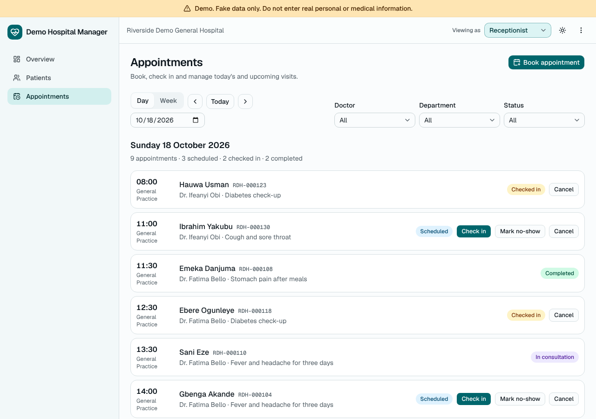

# Demo Hospital Manager

A hospital management system **demo** for the fictional **Riverside Demo
General Hospital**, built by Emmanuel Kelvin as a portfolio project.

> **Demo. Fake data only. Do not enter real personal or medical information.**
>
> Every patient, staff member, phone number, address and record in this app is
> invented. It gives no medical advice, provides no clinical decision support,
> and makes no claim to meet any healthcare, privacy or data-protection
> regulation.



<!-- Screenshot placeholder: swap in your own captures with
     SCREENSHOTS=1 npm run test:e2e -- e2e/screenshots.spec.ts -->

## What it demonstrates

- **A product-quality front end**: Next.js App Router, TypeScript (strict),
  Tailwind CSS v4 and shadcn/ui; mobile first; light, dark and system themes
  with no flash on load.
- **Per-visitor sandboxes**: "Explore the demo" signs the visitor in
  anonymously with Firebase Auth. Their data lives under `users/{uid}/...` in
  Firestore, is seeded on first entry, updates in real time, and is deleted
  when they sign out.
- **Security rules with tests**: `firestore.rules` denies everything outside
  the visitor's own sandbox, validates every field (types, lengths, ranges,
  no unknown fields) and only allows sensible status changes. An emulator test
  suite checks every allowed and denied transition, cross-user access, and
  worst-case documents against Firestore's 1000-expression evaluation limit.
- **Typed data layer**: one Zod schema per entity, typed repository helpers
  (Timestamps become Dates, documents are validated on read) and real-time
  hooks with loading, error and retry states.
- **Reception workflows** (this step): patient register with search, sorting
  and paging kept in the URL; registration and editing with React Hook Form
  and Zod; patient detail with visits, invoices and allergies; a safe delete
  that shows exactly what will be removed and offers Undo; an appointment book
  with day and week views, filters, booking, check-in, no-show and
  cancellation.
- **A role switcher** (Receptionist, Doctor, Lab, Pharmacist, Cashier, Admin)
  that changes the navigation. It is a UI demonstration, not access control.
  The doctor, lab, pharmacy, billing, staff and audit screens are placeholders
  in this step ("Coming in the next step").
- **Money in naira**, stored as integer kobo and formatted with
  `Intl.NumberFormat("en-NG", { style: "currency", currency: "NGN" })`.
- **Accessibility work**: semantic landmarks, skip link, keyboard support,
  visible focus, focus moved to the page heading on navigation, AA contrast,
  `prefers-reduced-motion`. Every page and dialog is checked with axe-core.

## Stack

Next.js 16 (App Router, Cache Components) · React 19 · TypeScript · Tailwind
CSS v4 · shadcn/ui (Radix) · Firebase JS SDK (Auth + Firestore, client only) ·
Zod · React Hook Form · date-fns · Recharts (installed for the next step) ·
Vitest · Playwright + axe-core · Prettier · npm.

There is no server code, no Firebase Admin SDK and no service account. The
only configuration is public: the `NEXT_PUBLIC_FIREBASE_*` web config,
`NEXT_PUBLIC_SITE_URL` and `NEXT_PUBLIC_PORTFOLIO_URL`.

## Set up a Firebase project

1. In the [Firebase console](https://console.firebase.google.com/), create a
   project.
2. **Authentication** > Sign-in method: enable **Anonymous**.
3. **Firestore Database**: create a database (production mode is fine; the
   rules below replace the defaults).
4. **Project settings** > Your apps: add a **Web app** and copy its config
   values.
5. **Firestore Database** > Rules: paste the full contents of
   [`firestore.rules`](firestore.rules) and click **Publish**. This repo never
   deploys rules for you.
6. Optional: **Authentication** > Settings > Authorised domains: add the domain
   you deploy to.

The rules allow only the signed-in visitor to read and write their own
`users/{uid}/...` documents. Payments on an invoice are appended one at a time
and only changed parts of a document are re-checked, which keeps the largest
allowed documents inside Firestore's rule-evaluation budget; the comments in
the rules file explain each choice.

## Environment variables

Copy `.env.example` to `.env.local` and fill it in:

| Variable                                   | Purpose                                       |
| ------------------------------------------ | --------------------------------------------- |
| `NEXT_PUBLIC_FIREBASE_API_KEY`             | Web app config                                |
| `NEXT_PUBLIC_FIREBASE_AUTH_DOMAIN`         | Web app config                                |
| `NEXT_PUBLIC_FIREBASE_PROJECT_ID`          | Web app config                                |
| `NEXT_PUBLIC_FIREBASE_STORAGE_BUCKET`      | Web app config                                |
| `NEXT_PUBLIC_FIREBASE_MESSAGING_SENDER_ID` | Web app config                                |
| `NEXT_PUBLIC_FIREBASE_APP_ID`              | Web app config                                |
| `NEXT_PUBLIC_SITE_URL`                     | Canonical site URL for metadata               |
| `NEXT_PUBLIC_PORTFOLIO_URL`                | "Built by" portfolio link (hidden when empty) |
| `NEXT_PUBLIC_FIREBASE_USE_EMULATORS`       | `true` to use the local emulators             |

The Firebase web config is a set of public identifiers, not secrets; the
security rules protect the data. Never put a service account or any other
secret in this file. Only `.env.example` is committed.

Without the Firebase values the site still builds and shows a "Firebase is not
configured" screen instead of the app.

## Run locally

Requires Node.js 20.9+ (22 recommended) and, for the emulators, Java 11+.

```bash
npm install
cp .env.example .env.local   # fill in your Firebase web config
npm run dev                  # http://localhost:3000
```

### Emulator mode (no Firebase project needed)

```bash
npm run emulators            # Auth on :9099, Firestore on :8080
```

In another terminal, set `NEXT_PUBLIC_FIREBASE_USE_EMULATORS=true` in
`.env.local` (any non-empty placeholder values work for the other
`NEXT_PUBLIC_FIREBASE_*` variables, with `NEXT_PUBLIC_FIREBASE_PROJECT_ID=demo-hms`)
and run `npm run dev`.

## Quality checks

```bash
npm run lint           # ESLint (Next.js + TypeScript rules)
npm run format:check   # Prettier
npm test               # Vitest unit tests: schemas, seed data, planners, tables
npm run test:rules     # Firestore rules tests against the emulator
npm run build          # production build
npm run test:e2e       # Playwright against the emulators (see below)
```

`npm run test:e2e` builds the app into `.next-e2e` with emulator settings,
starts the Auth and Firestore emulators, and runs the browser suite at 375,
768 and 1280 px in light and dark themes: sign-in and seeding, role switching,
registering and editing patients, search and URL state, safe delete with Undo,
booking and status changes, reset, sign out (checked against the emulator),
persistence after reload, keyboard focus, no horizontal overflow, no console
errors, and an axe-core audit of every page and dialog. Install a browser
first with `npx playwright install chromium`, or point
`PLAYWRIGHT_CHROMIUM_PATH` at an existing Chromium.

## Project layout

```
firestore.rules            Security rules (paste into the console)
src/app/                   Routes: landing, about, /app/*
src/components/            UI: app shell, patients, appointments, theme, shadcn/ui
src/lib/firebase/          Client init, config flag, AuthProvider
src/lib/hms/               Schemas, types, repo helpers, hooks, seed, actions
tests/rules/               Firestore rules tests (emulator)
e2e/                       Playwright + axe-core browser tests
```

## Data and privacy in the demo

Each visitor's sandbox is private to their anonymous session. Signing out
deletes the sandbox (best effort). The demo audit trail is append-only by
design, so its entries remain; you can clear old anonymous users and their
leftover entries from the Firebase console at any time.
